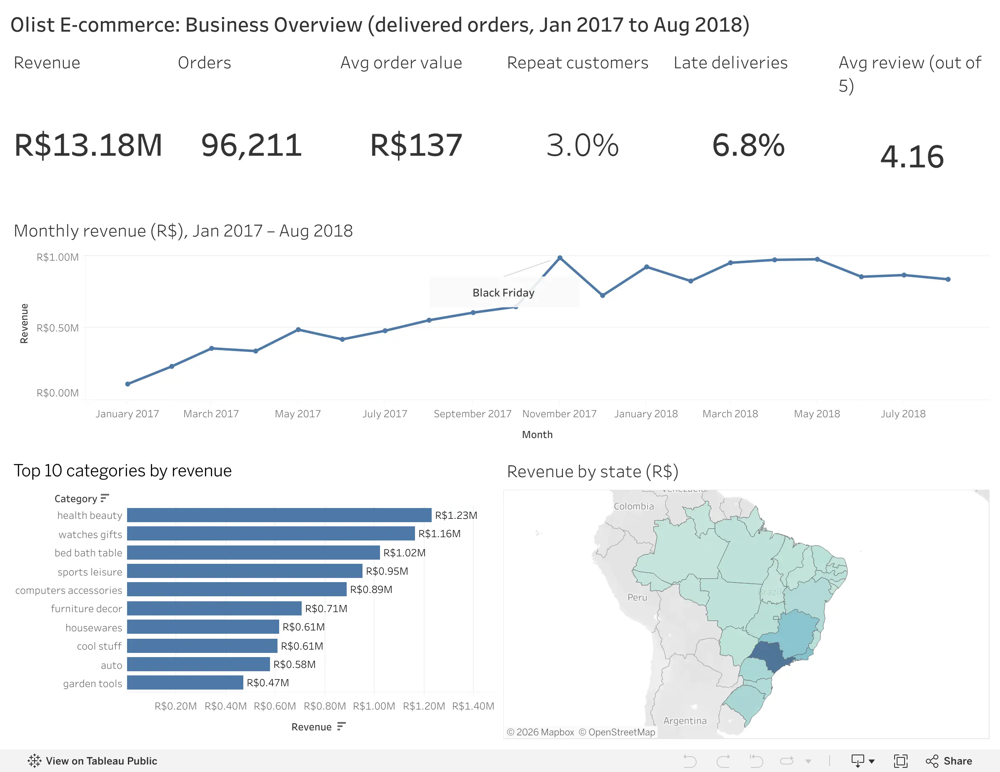
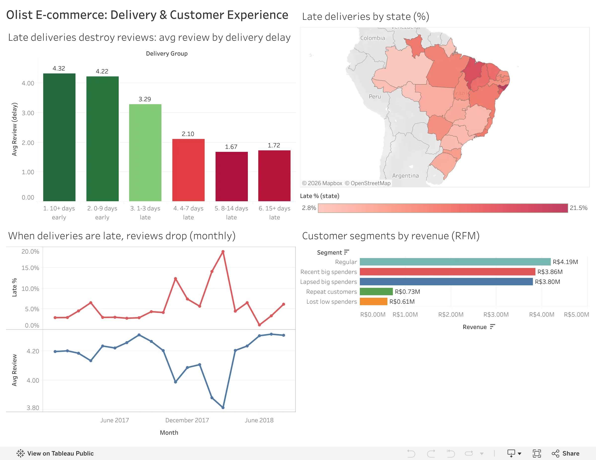

# 🛒 Olist E-commerce Analysis (SQL + Tableau)

SQL analysis of **~100,000 orders** from Olist, a Brazilian online marketplace, across 8 linked tables, turned into an interactive Tableau dashboard. It answers: *How is the business growing? Do customers come back? What hurts customer satisfaction?*

**🔗 Interactive dashboard:** [Olist E-commerce Dashboard on Tableau Public](https://public.tableau.com/app/profile/omkar.bhosale6092/viz/OlistE-commerceDashboard_17941597904740/BusinessOverview)



## Key findings

| | Finding |
|---|---|
| 💰 **Revenue** | R$ 13.18M from 96,211 delivered orders (Jan 2017 – Aug 2018), average order value R$ 137 |
| 📈 **Growth stalled** | Revenue grew ~8× in 2017 (Black Friday Nov 2017: +52% month over month), then stayed flat through 2018. Year-over-year growth fell from +727% to +51% |
| 🔁 **Almost no repeat customers** | Only **3.0%** of 93,104 customers ever ordered again (5.5% of revenue). Olist depends on finding new customers |
| 🚚 **Late deliveries destroy reviews** | Late orders average **2.27★ vs 4.29★** on time; **54% of late orders get 1 star**. After a week late, ~80% of reviews are bad |
| 🗺️ **Regional gaps** | São Paulo = 38% of revenue. Rio de Janeiro (#2 market) and the Northeast are late 3–4× more often than São Paulo |
| 🏷️ **Concentration** | 18 of 74 categories make 80% of revenue; orders above R$200 are 15% of orders but 50% of revenue |



## Recommendations

1. **Fix logistics in Rio de Janeiro and the Northeast first**: the most late orders and the biggest review damage.
2. **Plan carrier capacity before Black Friday** and investigate the Feb–Mar 2018 delays (up to 19% late).
3. **Run a second-purchase campaign** for the 14,441 recent high spenders, and a win-back campaign for the 13,745 lapsed high spenders.
4. **Send a proactive apology and voucher for late orders**, before the customer leaves a review.

## What's in each notebook

| Notebook | SQL skills | Question |
|---|---|---|
| [01 Load & explore](notebooks/01_load_and_explore.ipynb) | `CREATE TABLE`, primary keys, `UNION ALL`, data quality checks | What's in the data, and can we trust it? |
| [02 Joins & revenue](notebooks/02_joins_revenue.ipynb) | `INNER` vs `LEFT JOIN`, fan-out, `COALESCE`, `CASE WHEN`, subqueries | Revenue by month, category, state and order size |
| [03 Window functions](notebooks/03_window_functions.ipynb) | `LAG`, running totals, moving averages, `RANK` / `DENSE_RANK`, `PARTITION BY`, CTEs | Month-over-month and year-over-year growth, top categories per state |
| [04 Customer analytics](notebooks/04_customer_analytics.ipynb) | Changing the grain, cohort retention, RFM segmentation with `NTILE` | Do customers come back? Who are the best customers? |
| [05 Delivery vs reviews](notebooks/05_delivery_reviews.ipynb) | Deduplication with `ROW_NUMBER`, `HAVING`, `CORR`, reusable queries | Do late deliveries cause bad reviews? |
| [06 Export for Tableau](notebooks/06_export_for_tableau.ipynb) | Aggregating before joining, reconciliation checks | Small, consistent summary tables for the dashboard |

## Data quality lessons

- **`customer_id` is created per order.** Counting customers with it shows *zero* repeat buyers; the real person is `customer_unique_id`.
- **Fan-out:** joining orders to order items gives 109,880 rows for 96,211 orders, so orders are counted with `COUNT(DISTINCT order_id)`.
- **An `INNER JOIN` to the category table silently dropped 1,557 items** (products with no category); `LEFT JOIN` + `COALESCE` keeps that revenue.
- **Incomplete edges:** 2016 and Sept–Oct 2018 are nearly empty, so trends use Jan 2017 – Aug 2018 only.
- **Ties in `NTILE`:** RFM segment counts changed on every run until a unique tie-breaker was added.
- **Dashboard ratios are computed from sums** (e.g. `SUM(late orders) / SUM(orders)`), never by averaging percentages.

## Tools

**SQL:** DuckDB (PostgreSQL-style SQL) in Jupyter via JupySQL · **Python:** pandas · **Dashboard:** Tableau Public

## Project structure

```
├── notebooks/        # 01 → 06, SQL analysis
├── dashboard/data/   # summary tables exported for Tableau
├── images/           # dashboard screenshots
├── data/             # raw Olist CSVs + DuckDB file (not in the repo, see below)
└── requirements.txt
```

## How to run

1. Download the [Brazilian E-Commerce Public Dataset by Olist](https://www.kaggle.com/datasets/olistbr/brazilian-ecommerce) from Kaggle and put the CSV files in `data/`.
2. Set up the environment:
   ```bash
   python -m venv .venv
   source .venv/bin/activate
   pip install -r requirements.txt
   ```
3. Run the notebooks in order. Notebook 01 builds `data/olist.duckdb`; the others read from it.

**Data:** Olist, *Brazilian E-Commerce Public Dataset* (Kaggle, CC BY-NC-SA 4.0). Amounts are in Brazilian Real (R$).
